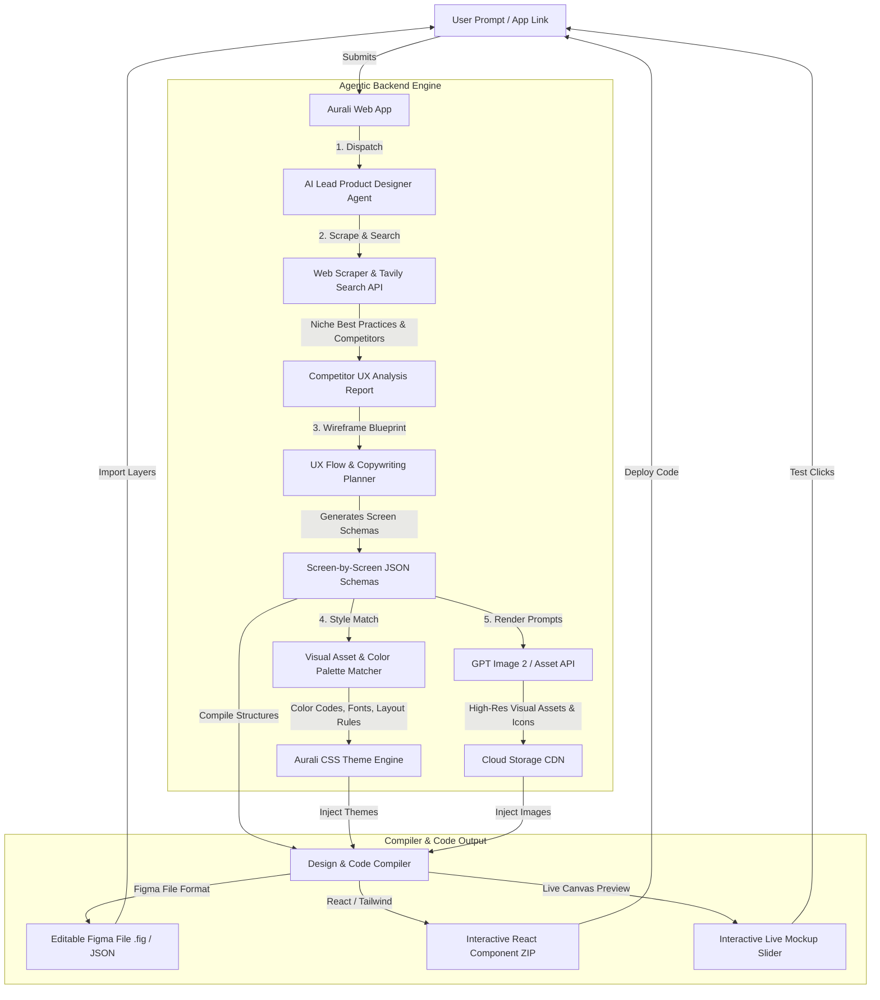
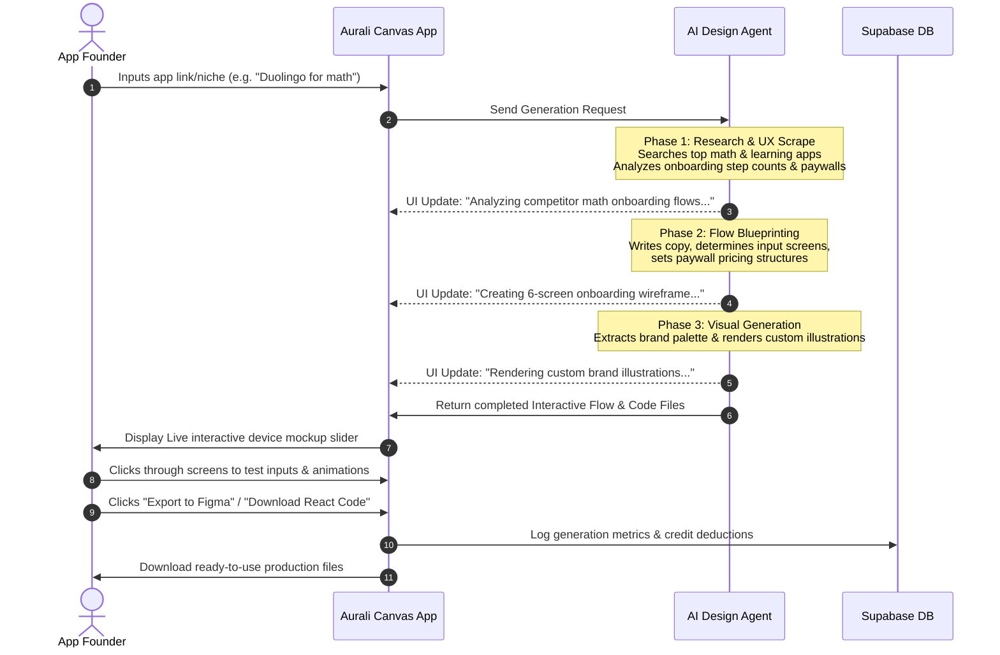

# Aurali AI Onboarding & Screenshot Generator: Product Architecture

As your CTO and Co-Founder, I fully align with your vision. If we want Aurali to be a premium, category-defining SaaS rather than a simple utility, we must build an **Agentic Product Designer**. 

Below is the comprehensive technical architecture, user flow, and backend design system we will build to deliver this high-tier experience.

---

## 1. System Architecture Diagram
This diagram shows how user prompts trigger web research, layout wireframing, brand visual asset synthesis, and final Figma/code compilation.



---

## 2. Onboarding Feature User Flow Diagram
This shows the step-by-step path a customer takes when interacting with Aurali's onboarding generator.



---

## 3. Product Sitemap (Information Architecture)
Here is how the user interface is structured to expose these premium features.

```
aurali.design (Landing & Conversion)
├── / (Homepage: Hero, Steps Card Carousel, Early Bird LTD Pricing)
├── /payment.html (Checkout Redirection & Post-Purchase License Activation Portal)
├── /feedback.html (Public Roadmap & Feature Backlog submissions)
│
└── /app (Private Workspace Dashboard - Requires Login/LTD Activation)
    ├── /my-projects (Manage App Screen Sets & Onboarding Flows)
    │
    └── /editor (Core Creative Workspace Canvas)
        ├── Left Control Sidebar:
        │   ├── Brand Settings (Upload logo, fonts, select primary/secondary/accent colors)
        │   ├── Screenshot Configurator (Device frames, layout modes, background flows)
        │   └── Onboarding Flow Builder (Screen manager: add, remove, rearrange steps)
        │
        ├── Central Interactive Canvas:
        │   ├── Device Mockup Slider (Double View: ASO App Store mockup + Onboarding simulation)
        │   └── Live preview container (Interactable form inputs and animations)
        │
        └── Right Export Panel:
            ├── ASO Package (Download multi-device package for App Store/Google Play)
            ├── React/Tailwind Source Code (Export production-ready components zip)
            └── Figma Integration (Download editable Figma vector layers)
```

---

## 4. How the "Code & Figma Compiler" Works Under the Hood
To ensure our users get **fully editable Figma layers** and not flat PNGs, our backend compiler performs a node-tree conversion:

1.  **Figma API Translation:** Figma's document format is represented as a structured JSON tree containing frame nodes, vector paths, text nodes, and fill styles. Our compiler reads our `FlowJSON` schema and translates it directly into Figma's layout schema. We package this as a `.fig` binary or a JSON file that users can paste into Figma using our companion plugin.
2.  **Tailwind Code Compilation:** The compiler translates our component JSON nodes into standardized, clean JSX. It outputs semantic HTML elements wrapped in Tailwind utility classes, keeping inline styles to absolute zero.

This architecture ensures Aurali is perceived as a highly premium, developer-centric tool that saves weeks of design and engineering resources.
